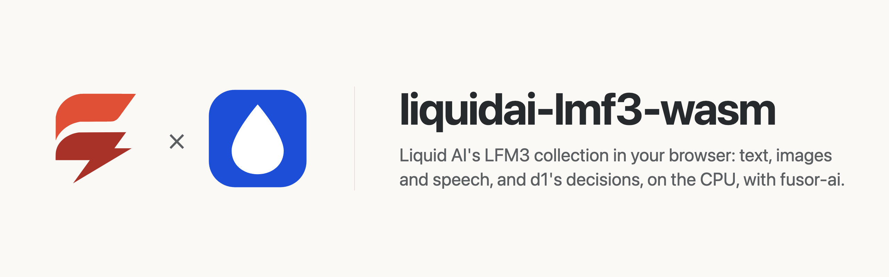
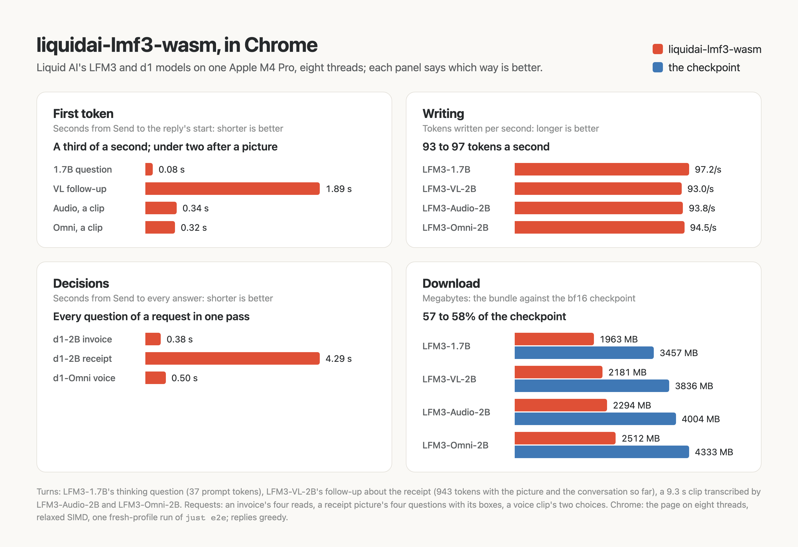

<p>
  <picture>
    <source media="(prefers-color-scheme: dark)" srcset="assets/brand/banner-dark.png">
    
  </picture>
</p>

# Liquid AI's LFM3 in the browser, on the CPU

**[Try it in your browser](https://huggingface.co/spaces/fusorlabs/liquidai-lmf3-wasm)**: no install, no server. The model downloads once and runs on your CPU.

**Replies written at 93 to 97 tokens a second, a clip's transcript started in a third of a second, a request's every answer in 0.4 s**, in headless Chrome on an Apple M4 Pro, eight threads. [How fast is it](#how-fast-is-it)

<a href="https://huggingface.co/spaces/fusorlabs/liquidai-lmf3-wasm"></a>

Pick a model of Liquid AI's [LFM3 collection](https://huggingface.co/collections/LiquidAI/lfm3), [LFM3-1.7B](https://huggingface.co/LiquidAI/LFM3-1.7B) for text, [LFM3-VL-2B](https://huggingface.co/LiquidAI/LFM3-VL-2B) to ask about images too, [LFM3-Audio-2B](https://huggingface.co/LiquidAI/LFM3-Audio-2B) to talk with it in speech, or [LFM3-Omni-2B](https://huggingface.co/LiquidAI/LFM3-Omni-2B) for all of it, let it reason in a thinking block first or answer straight away, and read or hear each reply as it is written; or have the decision models [d1-2B](https://huggingface.co/LiquidAI/d1-2B) and [d1-Omni-2B](https://huggingface.co/LiquidAI/d1-Omni-2B) answer named, typed questions about a state, its images and, for d1-Omni-2B, its audio in one pass, computed on your own device. No server, no API key, no GPU required, and once the model has loaded, nothing you type, show or say leaves the page.

liquidai-lmf3-wasm is the app around the collection's models: a [fusor](https://github.com/fusor-rs/fusor) page, the browser runtime and a native CLI. The models themselves, compiled to WebAssembly, are built with [fusor-ai](https://github.com/fusor-rs/fusor-ai), the toolkit for AI runtimes in Rust and WebAssembly, from the published weights. Today it runs LFM3-1.7B, LFM3-VL-2B, LFM3-Audio-2B, LFM3-Omni-2B, d1-2B and d1-Omni-2B.

**In development · v0.1**: this is experimental software. See [status and known limitations](#status-and-known-limitations).

[Run it](#run-it-locally) · [Try it online](#try-it-online) · [How it works](#how-it-works) · [How fast is it](#how-fast-is-it) · [Status](#status-and-known-limitations)

## Run it locally

You need Rust 1.99 or newer, installed with [rustup](https://rustup.rs), Node.js 22 or newer and [`just`](https://github.com/casey/just). Then:

```sh
git clone --recurse-submodules https://github.com/fusor-rs/liquidai-lmf3-wasm && cd liquidai-lmf3-wasm
just ui
```

and open the address it prints. `just ui` installs the pinned tools (the threads toolchain with rustup; wasm-bindgen, binaryen and the fusor CLI into `.tools/`), downloads each model's checkpoint at a pinned revision (3.5 GB, 3.9 GB, 4.2 GB, 4.5 GB, 3.9 GB and 4.4 GB, each file sha256-checked), compiles each into a 7-bit bundle, builds the browser runtimes, four builds each of LFM3's and d1's (a few minutes the first time, seconds after), and the page, and serves it on `http://localhost:8787` with the bundles beside it.

Pick the model at the top of the page: LFM3-1.7B loads unless you choose LFM3-VL-2B, and each loads its own bundle. Write a message, or start from an example (a question, a puzzle, a haiku), and press **Send**, even while the model is still loading: the message is replied to the moment the model is ready. With LFM3-VL-2B or LFM3-Omni-2B, drop, paste or choose images for the next message: they go with it, before its text, as the model's chat template places them, and stay in the conversation for the turns after it. With LFM3-Audio-2B and LFM3-Omni-2B, choose audio files or record from the microphone (the page asks for it; the model only ever gets the samples) for the next message, and choose how it replies: in text, as a transcript of the speech (ASR, in a language you name), as speech (TTS, in a language and a female or male voice you name), or in text and speech in turns; spoken replies play as they are generated, at 24 kHz. The reply streams in, its Markdown drawn. **Think before replying** is on by default, as in the model's chat template: the model reasons first in a thinking block, and its reasoning folds away once the answer starts; turn it off for a direct answer. Every later message continues the same conversation until **New conversation**. **Sampling** takes the model card's settings for each turn (a temperature of 0.1 over the 50 likeliest tokens) or your own temperature, top-p, top-k and presence penalty, and the longest reply. Every reply is measured live: the time from Send to its first token, the tokens written per second, the conversation's tokens and those the turn read, and the network requests since the model loaded, which stay at zero.

With d1-2B or d1-Omni-2B the page asks questions instead of holding a conversation. Write a state (text, or JSON, read as JSON when it parses; empty when the media are the whole state) and the questions, a JSON object of named, typed questions, or start from an example (a ticket's triage, an invoice's values, things found in a picture); add images, and with d1-Omni-2B audio clips, chosen or recorded; and press **Send**. The model answers every question in one pass, generating nothing, each answer in a card: a `noul`'s P(yes); a `choice`'s likeliest option and every option's probability, or with `"multiple": true` every option at a P(yes) of one half or more; a `score`'s median level and its legend, every level's probability drawn; a `text`, `number` or `date` read from the state as its value (a number's magnitude, a date in ISO 8601, parsed as the checkpoint's `parsing.py` does) beside the text read, its span of the state's characters, its JSON path in a JSON state and a number's unit; a `number` with a `"range"` and an optional `"step"` estimated as its median and its central 80 percent interval; a `box` or every instance of `boxes` (at most `"max"`, 16 unless asked) drawn over the picture, labelled by its question's name. The images and clips stay for the next request: edit the questions and send again. Each request is measured: the model's load, the time from Send to every answer, the tokens read, the packs (each the state and up to 16 questions after it, read in one pass) and the network requests since the model loaded.

## Try it online

Open the Hugging Face Space [fusorlabs/liquidai-lmf3-wasm](https://huggingface.co/spaces/fusorlabs/liquidai-lmf3-wasm) in Chrome or Edge. The page downloads the model once and keeps it in the browser's storage, so the next visit loads from this device.

## More ways to run it

### Build everything from source

```sh
just build    # also downloads the checkpoints (3.5 GB, 3.9 GB, 4.2 GB, 4.5 GB, 3.9 GB and 4.4 GB, sha256-checked) and compiles the bundles
just serve
```

`CHECKPOINTS=<dir>` reuses checkpoints you already have, each in `<dir>/<model>` (`lfm3-1.7b`, `lfm3-vl-2b`, `lfm3-audio-2b`, `lfm3-omni-2b`, `d1-2b`, `d1-omni-2b`).

### The CLI

The CLI holds the conversations of a JSON file without a browser, turn by turn:

```sh
target/release/lfm3 chat dist/model/lfm3-1.7b fixtures/conversations/lfm3-1.7b.json
target/release/lfm3 chat dist/model/lfm3-vl-2b fixtures/conversations/lfm3-vl-2b.json --media fixtures/media
target/release/lfm3 chat dist/model/lfm3-audio-2b fixtures/conversations/lfm3-audio-2b.json --media fixtures/media --speech speech
```

A turn's `images` and `audio` (16-bit WAV clips at 16 kHz) are paths relative to `--media`; `just fixtures` downloads the fixed ones. A turn's `mode` is `text`, `transcribe`, `speech` or `interleaved`; each spoken reply is written to `<speech>/<conversation>.<turn>.wav`.

`lfm3 bench` measures each stage on a conversation's first turn and `lfm3 parity` compares every stage with the reference's outputs.

The d1 CLI decides the requests of a JSON file, each case's `state` and `questions` with its `images` and its `clips` (16-bit mono WAV files at 16 kHz, d1-Omni-2B only), paths relative to `--media`:

```sh
target/release/d1 decide dist/model/d1-2b fixtures/requests/d1-2b.json --media fixtures/media
```

`d1 bench` measures each stage on one case and `d1 parity` compares every stage with the reference's outputs.

## How it works

- **The reference's prompt, token for token.** Each turn's prompt is the whole conversation as the model's chat template writes it: the conversation's system text when it has one, each earlier reply written back behind an empty thinking block, without its reasoning, and the reply's opener with its thinking block open or empty.
- **Images as the model's processor reads them.** LFM3-VL-2B resizes each image to whole 32-pixel blocks within 65,536 to 1,638,400 pixels (the checkpoint's limit of 16.8 million lowered to 1,600 tokens), cuts it into 16-pixel patches and reads them through its 14-layer vision tower, gated 3 × 3 convolutions between attention layers rotated by each patch's row and column; its projector turns each 2 × 2 block of patches into one token of the prompt.
- **Speech as the model hears and speaks it.** LFM3-Audio-2B and LFM3-Omni-2B take each clip's 128-bin log-mel features at 16 kHz, fold every 8 frames into one token through convolutions and LFM2's 17-layer encoder (gated short convolutions between attention over the last 32 tokens), and project each into the prompt. A spoken frame's 12 codes are drawn from the language model's state by a depth decoder that reveals them 4 at a time, in a random order; the codec's decoder turns each frame into 1,920 samples at 24 kHz through an inverse STFT, streamed as the reply speaks.
- **Every turn reads the whole conversation.** LFM3-1.7B's 24 layers mix their tokens three ways: gated short convolutions over the last 7 tokens, attention over the whole conversation, and attention over a window of its last 256 tokens, each attention head's output through a gate of its own. Since the template writes a reply back without its reasoning, and the window and convolution layers keep only their last rows, each turn reads its prompt again from the first token: a follow-up's first token comes later the longer the conversation.
- **Sampled as the model card says.** Each turn draws its tokens with the model card's temperature and top-k, from a seed the page draws; a temperature of 0 replies greedily, as the checks do.
- **Quantized.** Every large matrix is 7-bit but the patch embedding and the audio subsampler's, 1963 MB (LFM3-1.7B) to 2512 MB (LFM3-Omni-2B) against the 3.5 to 4.3 GB bf16 checkpoints; the input embeddings and the output head are one tied matrix, as in the checkpoints.
- **Decisions in one pass.** d1-2B and d1-Omni-2B are LFM3-VL-2B's and LFM3-Omni-2B's language model and media encoders, fine-tuned. Each question is written after the state as the checkpoint's prompt writes it, up to 16 in a pack read in one pass, whose full attention layers read the state with every question and each question with the state and itself. Each answer is read off the output head at its slots, or for a read off pointer scores over the state's tokens, and calibrated by the checkpoint's `calibration.json`. An image is scaled down to at most 1,638,400 pixels before its processor reads it.
- **One stage per step.** The engine worker replies in steps (each image, each clip, the prompt, then each token or spoken frame) and posts each, so the reply streams and Stop takes effect between steps.
- **Threads and SIMD where the browser has them.** The page picks one of four builds: worker threads when it is cross-origin isolated, relaxed SIMD when the engine supports it, plain SIMD128 everywhere else.
- **Downloaded once, verified always.** The bundle streams in parts, each checked against its BLAKE3 hash, and stays in the browser's origin-private storage, so the next visit loads from this device.
- **Sealed.** The runtime imports no network, storage, clock or entropy capability; fusor-ai's import check proves it on every build. The page counts its network requests while it replies, and the count is zero.

## How fast is it

On an Apple M4 Pro in headless Chrome on eight threads (`web-threaded-relaxed`), LFM3-1.7B's thinking question of 37 prompt tokens starts its reply in 0.08 s and writes 97 tokens a second; LFM3-VL-2B's follow-up about the receipt, 943 tokens with the picture and the conversation so far, starts in 1.89 s and writes 93 a second; LFM3-Audio-2B and LFM3-Omni-2B start the transcript of a 9.3 s clip in 0.34 s and 0.32 s and write 94 and 95 tokens a second. d1-2B answers an invoice's four reads in 0.38 s and a receipt picture's four questions, its boxes drawn, in 4.29 s; d1-Omni-2B a voice clip's two choices in 0.50 s. A revisit loads d1-Omni-2B's 2321 MB bundle from the browser's storage in 2.5 s. Every fixed reply states the facts it is asked for, every spoken one is audible, and every decision is the reference's:

<picture>
  <source media="(prefers-color-scheme: dark)" srcset="assets/benchmarks/benchmarks-dark.png">
  
</picture>

These are the figures of one `just e2e` run (a fresh profile, other work on the machine); `just bench` breaks a turn down by stage natively.

## Documentation

| Guide | Covers |
| --- | --- |
| [AGENTS.md](AGENTS.md) | The code standard every change follows |

## Status and known limitations

liquidai-lmf3-wasm is v0.1 and experimental.

| Platform or capability | Status |
| --- | --- |
| Chrome and Edge, threads and relaxed SIMD | Headless Chrome end-to-end check (`just e2e`) of each model: send while loading, a conversation with a thinking turn, a second conversation, a conversation about an image, a clip transcribed, a reply spoken, text and speech in turns, each decision model's requests, revisit |
| Browsers without relaxed SIMD (Safari, older Firefox) | SIMD128 builds, checked in Node (`just smoke`); not tested in those browsers |
| Pages without cross-origin isolation | Single-threaded builds |
| Native CLI (macOS on Apple silicon) | Builds; run it on the fixed conversations and requests with `just chat` |
| Phones | Not measured; the threaded builds' memory may grow to 4 GB |

**Not supported yet:**

- For d1-2B and d1-Omni-2B: videos, spoken (audio) instructions, and the `set_size` and `score_readout` overrides. A `box` or `boxes` question needs exactly one image. A request holds at most 4 images and 4 clips, each clip mono at 16 kHz and up to 60 seconds, and at most 4,096 tokens in each pack of up to 16 questions after the state.
- Live speech recognition while the clip is recorded: a clip is heard once it is complete, up to 60 seconds.
- Spoken replies in later turns: the template writes a reply back as its text alone.
- Videos for LFM3-VL-2B, and images over 1,638,400 pixels at their own resolution: larger ones are scaled down to it.
- Conversations longer than 8,192 tokens: start a new one. A reply is at most 4,096 tokens.
- Reading only a turn's new tokens: every turn reads the whole conversation again.
- The model card's repetition penalty (1.1): the sampler penalizes by presence instead.
- A system prompt on the page (the runtime takes one), and tools and function calls.
- Bundles other than the 7-bit one.
- A GPU backend.

The models are Liquid AI's [LFM3-1.7B](https://huggingface.co/LiquidAI/LFM3-1.7B), [LFM3-VL-2B](https://huggingface.co/LiquidAI/LFM3-VL-2B), [LFM3-Audio-2B](https://huggingface.co/LiquidAI/LFM3-Audio-2B) [LFM3-Omni-2B](https://huggingface.co/LiquidAI/LFM3-Omni-2B), [d1-2B](https://huggingface.co/LiquidAI/d1-2B) and [d1-Omni-2B](https://huggingface.co/LiquidAI/d1-Omni-2B), under the LFM Open License v1.0; each bundle ships the license beside its weights (`model/<model>/LICENSE`).

## License

The code is licensed under the [MIT License](LICENSE). The models' weights are Liquid AI's, under the [LFM Open License v1.0](https://huggingface.co/LiquidAI/LFM3-1.7B/blob/main/LICENSE).
